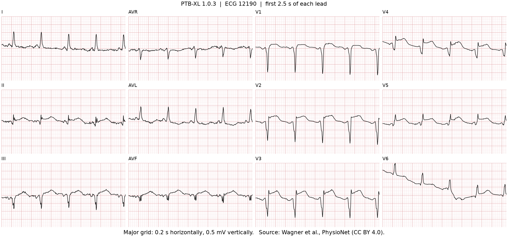

# MALBEC · 심근경색 아형 모델 재현

바젤대병원 연구진의 12유도 심전도 모델을 CPU에서 실행합니다. 저자들이 공개한 예제에서 기존 출력을 재현한 다음, 별도로 선택한 PhysioNet PTB-XL 기록에서 모델의 반응을 측정합니다.

- [선택한 PTB-XL 심전도](malbec/results/ptbxl/ptbxl_ecg.png) · [원 신호 및 헤더](malbec/results/ptbxl/) · [선정 기준과 원 판독](malbec/results/ptbxl/selection.json) · [실제 모델 출력](malbec/results/ptbxl/predictions.json)
- [공식 Python 소스 및 저자 노트북](malbec/upstream/src/) · [검증된 모델 체크포인트](https://github.com/joongwha/ai-model/releases/tag/malbec-zenodo-2.0.0) · [GitHub Actions 실행 기록](https://github.com/joongwha/ai-model/actions/workflows/ptbxl.yml)

## 실행 결과

PTB-XL **13913번**에서 원 모델의 STEMI sigmoid 점수는 **0.99983585**, 저자들의 isotonic 보정 후 출력은 **1.000000**이었습니다. 후자는 보정 함수의 최댓값입니다. 사람이 검토한 참조 판독은 V2–V4에서 특히 두드러지는 ST 상승과 III의 ST 하강을 동반한 최근 전벽·측벽 심근경색입니다. 모델은 STEMI를 분류하며 경색 위치나 관상동맥 폐색을 직접 판정하지 않습니다. 이 공개 증례 한 건만으로 진단 정확도를 추정할 수 없습니다. [성공한 GitHub Actions 실행](https://github.com/joongwha/ai-model/actions/runs/44300214483)



## 재실행

GitHub의 **Actions → Run MALBEC on PTB-XL → Run workflow**를 실행하거나, 로컬 Python 3.11 환경에서 아래 명령을 사용합니다. 체크포인트는 위 릴리스에서 받아 저장소 최상위에 둡니다.

```sh
python -m pip install torch==2.6.0 --index-url https://download.pytorch.org/whl/cpu
python -m pip install -r malbec/requirements.txt
python malbec/ptbxl_case.py --checkpoint finetuned_18d5a8abc508439a82786289b8f67ccc.ckpt --output results
```

## 어떤 기록을 어떻게 평가하는가

1. PTB-XL v1.0.3에서 사람이 검토한 전벽·전중격·전측벽 경색 코드(확신도 100), 경색 I기 기록들의 판독문을 [모델 없이 조회](https://github.com/joongwha/ai-model/actions/runs/44300055860)했습니다. V2–V4에서 특히 현저한 ST 상승, III에서 ST 하강, 최근 전벽·측벽경색을 함께 명시한 **13913번**을 모양이 비슷한 공개 사례로 선택했습니다. 이 번호와 판독문 조건을 코드에 고정한 뒤 모델을 실행합니다.
2. 선택된 WFDB 원본의 12유도 순서와 단위, 500 Hz × 10초를 검사합니다. mV를 µV로 변환한 뒤 저자들의 디지털 필터와 선형 보간 순서로 4,096개 표본을 만들고, 공개 노트북의 평균과 표준편차로 정규화합니다. 그래프는 가독성을 위해 각 유도의 같은 첫 2.5초를 보여줍니다.
3. 공식 예제 5건에서 STEMI의 보정 전·후 점수를 저자 노트북에 저장된 값과 절대오차 0.0001 이내에서 비교합니다. 이어 같은 체크포인트로 PTB-XL 심전도를 평가하고 `predictions.json`에 기록합니다. 여섯 개 sigmoid 출력은 독립 점수입니다. STEMI 배제가 확인된 예제에 한해 저자 노트북의 NSTEMI 보정 절차를 적용합니다. 모델에는 OMI나 병변 위치를 직접 출력하는 항목이 없습니다.
4. PTB-XL 판독과 한 증례의 모델 결과를 비교하는 실험입니다. 아형별 임상 진단 정확도나 실제 LAD 폐색 여부를 평가하려면 별도 표준진단을 갖춘 코호트가 필요합니다. 원래의 3×4 인쇄 ECG 사진과 이 공개 증례는 서로 다른 기록입니다.

초기 검색에서 선택된 두 기록도 보관합니다. 09543번의 판독은 아급성 전벽경색과 지속 ST 상승 및 심실류 감별을, 12190번은 급성 가능성을 언급합니다. [09543번](malbec/results/subacute-09543/) · [12190번](malbec/results/possible-acute-12190/)

## 다른 디지털 원파형

이미 저자 형식으로 전처리한 HDF5는 아래처럼 평가합니다. `data`는 µV 단위의 `N × 12 × 4096` 배열(각 유도 10초), `hash`는 같은 순서의 기록 식별자입니다. 유도 순서는 I, II, III, aVR, aVL, aVF, V1–V6입니다. 임상적으로 STEMI가 배제된 집단에서만 `--stemi-excluded`를 사용합니다.

```sh
python malbec/predict.py your_waveform.h5 --checkpoint finetuned_18d5a8abc508439a82786289b8f67ccc.ckpt
```

## 출처 및 이용 조건

- Zimmermann T, Strebel I, et al. *Training and validation of a 12-lead ECG-based deep-learning model for myocardial infarction subtypes.* npj Digital Medicine, 2026. [논문](https://doi.org/10.1038/s41746-026-03204-1) · [GitLab 원본](https://gitlab.com/usbch/crib/malbec/training-and-validation-of-a-12-lead-ecg-based-deep-learning-model-for-myocardial-infarction-subtypes) (`9f9dc7d22663345cffee67c52068149e4cff8ab4`) · [Zenodo v2.0.0](https://doi.org/10.5281/zenodo.19627196) · [GPL-3.0 라이선스](malbec/upstream/LICENSE)
- 체크포인트 SHA-256은 `293f5f9b5317c279172d9f1f3b8dadc67d23513ccc058e93db15352d8b5fc986`입니다.
- Wagner P, Strodthoff N, Bousseljot R-D, et al. *PTB-XL, a large publicly available electrocardiography dataset*, v1.0.3. 원시 WFDB 파일은 원형으로 복사했고, 그림과 모델 입력 변환은 이 저장소에서 생성했습니다. [데이터](https://doi.org/10.13026/kfzx-aw45) · [원 논문](https://doi.org/10.1038/s41597-020-0495-6) · [CC BY 4.0](https://creativecommons.org/licenses/by/4.0/)
